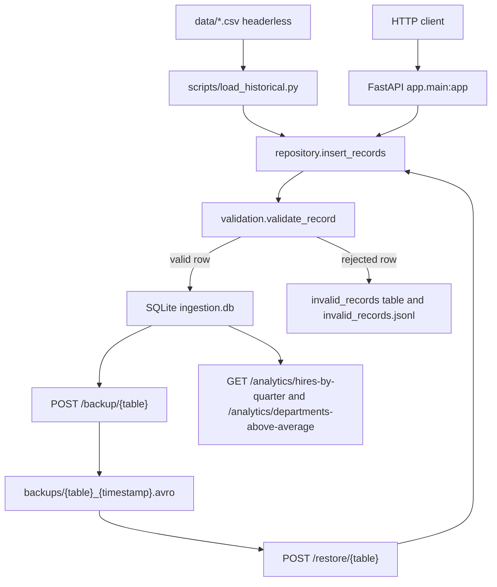

# FastAPI data ingestion with AVRO backup

Local proof of concept and portfolio project built on sample data. It loads three historical CSV tables into SQLite, validates batch uploads, stores rejected rows, backs up and restores each table as AVRO, and serves two hiring reports for 2021.

Python 3.12 is the version used to produce the numbers below (CPython 3.12.3). The API is FastAPI. The database is a single SQLite file. AVRO read and write uses `fastavro`.

## Problem

The exercise needs a repeatable pipeline for three related tables:

| Table | Columns |
| --- | --- |
| `departments` | `id`, `department` |
| `jobs` | `id`, `job` |
| `hired_employees` | `id`, `name`, `datetime`, `department_id`, `job_id` |

The pipeline has to:

- load the historical CSV files into SQL
- accept later batches of 1 to 1000 rows over HTTP, insert the valid rows, and record why the others were rejected
- write a full-table AVRO backup and load that file back
- report 2021 hires by department, job, and quarter
- list departments whose 2021 hires are above the mean for all departments

SQLite keeps the project runnable with no external database. The schema, foreign keys, and report queries are SQLite SQL.

## Architecture



A request opens one SQLite connection, commits on success, and rolls back when the request raises. The JSONL file is appended as soon as a row is rejected, outside that transaction.

## Layout

```text
app/
  main.py           HTTP routes
  validation.py     batch size, types, foreign keys, reject log
  repository.py     insert, fetch, restore
  analytics.py      the two 2021 reports
  avro_io.py        AVRO backup and restore
  database.py       SQLite schema and connections
  settings.py       paths and the batch limit of 1000
data/               sample CSVs, headerless
scripts/load_historical.py
tests/
```

These files are created locally and are gitignored:

- `ingestion.db`
- `invalid_records.jsonl`
- `backups/*.avro`

## Source data

`data/departments.csv`, `data/jobs.csv`, and `data/hired_employees.csv` ship with this repository as the sample input. They have no header row. The loader reads them as UTF-8 and strips a leading BOM if one is present. These copies have no BOM.

| File | Rows | Columns |
| --- | ---: | --- |
| `departments.csv` | 12 | `id`, `department` |
| `jobs.csv` | 183 | `id`, `job` |
| `hired_employees.csv` | 1,999 | `id`, `name`, `datetime`, `department_id`, `job_id` |

The employee file contains names from that sample dataset. It has no email addresses, phone numbers, or national identifiers. The historical load and the measured results depend on these three files. Keep them. Do not replace them with a real HR extract.

A short CSV row is padded with `null` for the missing columns. A `null` or empty field fails the required-field check.

## Validation rules

`POST /ingest/{table}` takes a JSON list. `{table}` is `departments`, `jobs`, or `hired_employees`. Any other name returns `404` with `{"detail": "Unknown table"}`.

The list must contain 1 to 1000 objects. An empty list, a longer list, or a JSON body that is not a list returns `422`. The historical loader uses the same row rules and sends the file in chunks of 1000.

Each row is accepted or rejected on its own. A rejected row does not stop the rest of the batch. Inserts use `INSERT OR REPLACE`, so a repeated `id` overwrites that row and still counts as inserted.

A field is required when the key is missing, `null`, or `""`. If any required field fails that check, type and foreign-key checks for that row are skipped.

| Table | Rules after the required-field check |
| --- | --- |
| `departments` | `id` integer, `department` non-empty text |
| `jobs` | `id` integer, `job` non-empty text |
| `hired_employees` | `id` integer, `name` non-empty text, `datetime` timestamp, `department_id` and `job_id` integers that already exist |

Integer values:

- a JSON integer, including `0` and negatives
- a string of digits, with optional surrounding spaces, such as `"42"` or `" 7 "`
- booleans are rejected
- floats, `"1.5"`, `"-2"`, and `"+2"` are rejected

Text values are stripped. A whitespace-only string is not treated as missing. It fails with `must be a non-empty string`.

`datetime` is stripped and must match `YYYY-MM-DDTHH:MM:SSZ`, for example `2021-07-27T16:02:08Z`. A different shape fails with `must be ISO 8601 format like 2021-07-27T16:02:08Z`. A value that matches the shape but is not a real calendar timestamp fails with the parser message, such as `day is out of range for month`. That parser error stops the foreign-key checks for the row.

Unknown JSON fields are ignored on a valid row. A rejected row is stored as it was submitted.

Rejected rows are written to the `invalid_records` table (`table_name`, `payload`, `errors`, `created_at`) and appended to `invalid_records.jsonl`:

```json
{"table": "jobs", "payload": {"id": 2, "job": ""}, "errors": ["job is required"]}
```

One JSON object per line.

Ingest response:

```json
{
  "table": "departments",
  "received": 2,
  "inserted": 1,
  "rejected": 1,
  "errors": [
    {"index": 1, "errors": ["department is required"]}
  ]
}
```

`index` is the position in the submitted list.

Example hire:

```json
[
  {
    "id": 6,
    "name": "Ada Example",
    "datetime": "2021-01-15T00:00:00Z",
    "department_id": 1,
    "job_id": 2
  }
]
```

`department_id` and `job_id` must already exist. Load or ingest departments and jobs before hires.

## Endpoints

Interactive docs are served at [http://127.0.0.1:8000/docs](http://127.0.0.1:8000/docs).

| Method | Path | Result |
| --- | --- | --- |
| `GET` | `/health` | `{"status": "ok"}` |
| `POST` | `/ingest/{table}` | validate and upsert one batch |
| `POST` | `/backup/{table}` | write the current table to AVRO |
| `POST` | `/restore/{table}` | upsert an AVRO file |
| `GET` | `/analytics/hires-by-quarter` | 2021 hires by department, job, and quarter |
| `GET` | `/analytics/departments-above-average` | departments above the 2021 mean |

### Hires by quarter

`GET /analytics/hires-by-quarter` keeps rows whose `datetime` starts with `2021`. It joins department and job names, counts hires in Q1 (Jan–Mar), Q2 (Apr–Jun), Q3 (Jul–Sep), and Q4 (Oct–Dec), and orders by department, then job.

```json
{"department": "Alpha", "job": "Analyst", "Q1": 2, "Q2": 0, "Q3": 1, "Q4": 0}
```

Departments with no 2021 hires are absent here because the query starts from `hired_employees`.

### Departments above the mean

`GET /analytics/departments-above-average` counts 2021 hires for every department, including departments with zero. It returns departments whose count is strictly greater than that mean, ordered by `hired` descending.

```json
{"id": 8, "department": "Support", "hired": 216}
```

Hires from other years stay in the table and are left out of both reports.

## AVRO backup and restore

`POST /backup/{table}` reads the table ordered by `id` and writes `backups/{table}_{YYYYMMDDHHMMSS}.avro`. The timestamp is UTC. The response `path` is the absolute filesystem path of that file:

```json
{
  "table": "departments",
  "records": 12,
  "path": "/path/to/backups/departments_YYYYMMDDHHMMSS.avro"
}
```

`POST /restore/{table}` expects that path back:

```json
{"file_path": "/path/to/backups/departments_YYYYMMDDHHMMSS.avro"}
```

A missing or blank `file_path` returns `422` with `{"detail": "file_path is required"}`.

Restore reads the file and upserts it with the same row rules as ingest, in batches of 1000. That batching is internal: `POST /ingest/{table}` still rejects a body outside 1 to 1000 rows, while a backup larger than 1000 rows can be restored. An empty backup restores as `0` rows.

```json
{
  "table": "departments",
  "restored": 12,
  "path": "/absolute/path/backups/departments_20261030183235.avro"
}
```

Restore order for a full snapshot is `departments`, then `jobs`, then `hired_employees`. Hire rows are rejected when the parent department or job is not already loaded.

One rejected row fails the restore. SQLite rolls back the rows and the `invalid_records` inserts from that request. Lines already appended to `invalid_records.jsonl` remain. Restore does not delete rows that are in the table and absent from the file.

The endpoint opens the `file_path` it is given. There is no authentication and no directory allow-list.

AVRO fields match the table columns. `datetime` is stored as a string.

## How to run

```bash
python3 -m venv .venv
source .venv/bin/activate
python -m pip install -r requirements-dev.txt
```

On Windows PowerShell, create the environment with `python -m venv .venv` and activate it with `.venv\Scripts\Activate.ps1`. After activation, `python` points at that environment. The Makefile uses `python3` unless you pass another interpreter, for example `make PYTHON=python test`.

`requirements.txt` is enough to run the API. `requirements-dev.txt` adds pytest, httpx, and ruff.

```bash
python scripts/load_historical.py
uvicorn app.main:app --reload
```

`load_historical.py` accepts `--data-dir` when the CSVs are not in `data/`.

The same commands are in the Makefile: `make install`, `make load`, `make run`.

## Tests

```bash
make test
make lint
make check
```

`make test` runs pytest. `make lint` runs Ruff check and format check. `make check` runs both.

Pytest points at a temporary database, backup directory, and JSONL file. It does not use `ingestion.db`.

Coverage includes validation helpers, batch limits, partial ingest, the CSV loader, backup and restore (including a backup larger than 1000 rows and a failed restore), both analytics endpoints, and one load of the sample CSVs.

GitHub Actions (`.github/workflows/ci.yml`) runs on push and pull request with Python 3.12. The job has `contents: read` and uses no secrets. It installs `requirements-dev.txt`, runs Ruff, and runs pytest.

## Measured run

Executed on 2026-10-30 with Python 3.12.3. `scripts/load_historical.py` loaded `data/` into a fresh SQLite file. The same numbers are asserted by `tests/test_sample_data.py`.

```text
{'table': 'departments', 'received': 12, 'inserted': 12, 'rejected': 0}
{'table': 'jobs', 'received': 183, 'inserted': 183, 'rejected': 0}
{'table': 'hired_employees', 'received': 1999, 'inserted': 1929, 'rejected': 70}
```

All 70 rejected hire rows had one blank required field:

| Error | Rows |
| --- | ---: |
| `department_id is required` | 21 |
| `name is required` | 19 |
| `job_id is required` | 16 |
| `datetime is required` | 14 |

Of the 1,929 stored hires, 1,643 have a 2021 timestamp and 286 have a 2022 timestamp.

`GET /analytics/hires-by-quarter` returned 933 department/job groups. Quarter totals, which add up to the 1,643 hires from 2021:

| Q1 | Q2 | Q3 | Q4 |
| ---: | ---: | ---: | ---: |
| 249 | 454 | 453 | 487 |

2021 hires by department. The mean is 1,643 / 12. Departments above that mean are marked.

| Department | 2021 hires | Above the mean |
| --- | ---: | --- |
| Support | 216 | yes |
| Engineering | 205 | yes |
| Human Resources | 201 | yes |
| Services | 200 | yes |
| Business Development | 185 | yes |
| Research and Development | 148 | yes |
| Marketing | 142 | yes |
| Training | 111 | |
| Sales | 93 | |
| Legal | 56 | |
| Product Management | 48 | |
| Accounting | 38 | |

`GET /analytics/departments-above-average` returned those seven departments in this order, with `id` values 8, 5, 6, 7, 4, 3, and 9.

The sample-data test backed up that load and restored it into an empty database: 12 department rows, 183 job rows, and 1,929 hire rows, matching the source tables. The hire backup is larger than the ingest limit of 1,000, so restore splits it internally.

## Limitations

- There is no authentication. Backup and restore read and write local files, and restore opens whatever `file_path` the caller sends.
- Restore upserts by primary key. Rows that are not in the AVRO file stay in the table.
- A failed restore rolls back SQLite, including rows it had staged, but rejected-row lines can already be in `invalid_records.jsonl`.
- The ingest batch limit remains 1 to 1000. Restore is what splits larger files.
- A missing required field hides later type and foreign-key errors for that row.
- The department mean includes departments with zero hires in 2021. A department equal to the mean is excluded.
- Reports and foreign keys are enforced in SQLite. The report SQL uses `strftime` and `substr`.

## Resumen en español

Esta prueba carga tres CSV históricos en SQLite, valida lotes de 1 a 1000 filas por API y guarda el motivo de cada fila rechazada. También respalda y restaura cada tabla en AVRO y publica dos reportes de contrataciones de 2021: por departamento, puesto y trimestre, y los departamentos por encima de la media. Los números de este README salen de una ejecución real con los CSV de `data/`.
